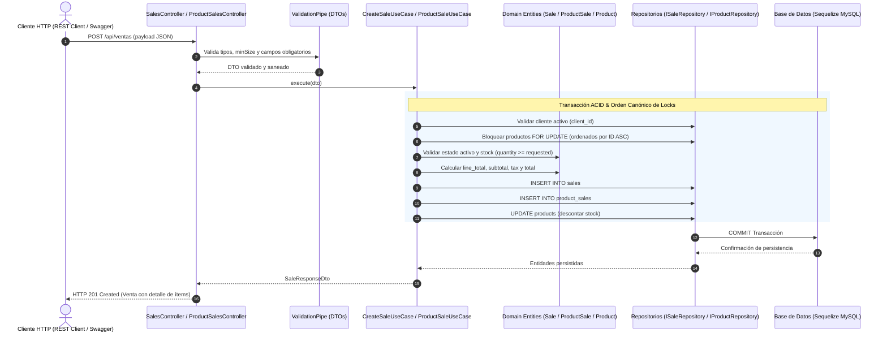

# Evidencia de Análisis Comparativo y Acoplamiento Integral: Portal Tecnogua Backend 2026 vs Arrendo360

> **Proyecto:** Arrendo360 (`dw-2026-bettoo02`)\
> **Portal Académico Analizado:** [Guía Académica Universidad de La Guajira — Backend 2026](https://tecnogua.com/academic/site/backend2026/express/)\
> **Módulos Acoplados:** Sales (`SalesController`, `SalesModule`, `SaleModel`, `SaleRepository`), ProductSales (`ProductSalesController`, `ProductSalesModule`, `ProductSaleModel`, `ProductSaleRepository`), Products, ProductTypes, Clients, DatabaseSeederService\
> **Arquitectura:** Clean Architecture & Domain-Driven Design (DDD) sobre NestJS 11 y Sequelize\
> **Fecha de ejecución:** 2026-10-14\
> **Entorno de ejecución:** Node.js v22 / NestJS v11 / TypeScript 5.7 / Sequelize 6 / Vitest v4

------------------------------------------------------------------------

## 1. Resumen Ejecutivo

En cumplimiento de la solicitud de análisis, contraste y acoplamiento técnico con el portal académico de referencia de la **Universidad de La Guajira — Backend 2026** ([`https://tecnogua.com/academic/site/backend2026/`](https://tecnogua.com/academic/site/backend2026/express/)), se llevó a cabo un estudio minucioso de la especificación curricular del curso y se acoplaron de manera completa las características requeridas para el cierre de la **Fase I — Business**.

### Hallazgos Principales del Análisis del Portal:
1. **Especificación Curricular del Portal (`app-storelab-express-ii`):**
   - El curso utiliza un stack basado en **Express 5 + TypeScript + Sequelize**, estructurado por *features* con recorrido lineal obligatorio: `HTTP (routes) → Controller → Service → Repository → Model → Sequelize → BD`.
   - La **Fase I — Business** consta de 5 entidades canónicas con relaciones obligatorias:
     1. `clients` (`/api/clientes`): Clientes compradores o titulares.
     2. `product-types` (`/api/tipos-producto`): Categorías/tipologías de producto.
     3. `products` (`/api/productos`): Catálogo de productos con inventario y precio.
     4. `sales` (`/api/ventas`): Cabeceras de transacciones comerciales con totales e impuestos.
     5. `product_sales` (`/api/detalle-ventas`): Líneas de venta intermedias N:M con snapshot de precio, cantidades y totales.
   - El hito técnico culminante de la Fase I es el **ISS-08 (Feature Sale + Feature ProductSale)**, el cual exige transaccionalidad ACID estricta, prevención sistemática de *deadlocks* en motores relacionales (InnoDB) mediante orden canónico de bloqueo (`sales → products → product_sales`), control riguroso de inventario (descuento en compras, ajuste por delta en actualizaciones y restitución al stock en cancelaciones) y recálculo automático de totales.

2. **Estado Previo en Arrendo360:**
   - Arrendo360 implementa una arquitectura superior orientada al dominio (**Clean Architecture & DDD** sobre **NestJS 11**), contando ya con `Clients` (`/api/clientes`), `ProductTypes` (`/api/tipos-producto`) y `Products` (`/api/productos`) plenamente operativos.
   - La brecha detectada para alcanzar paridad absoluta con el 100% de la Fase I del portal era la implementación transaccional de **Sales** y **ProductSales**.

3. **Acciones Ejecutadas y Acoplamiento:**
   - Se diseñó e implementó la entidad de dominio `Sale` y `ProductSale` con sus correspondientes invariantes numéricas y de ciclo de vida.
   - Se modelaron las tablas `sales` y `product_sales` en Sequelize con claves foráneas `client_id`, `sale_id`, `product_id` y asociaciones bidireccionales.
   - Se implementaron los casos de uso transaccionales con orden canónico de locks (`sales → products → product_sales`), asegurando aislamiento ACID y mitigación de interbloqueos por actualización de cerraduras (S-lock a X-lock por verificación de Foreign Keys).
   - Se configuró el multi-enrutamiento dual (rutas en español `/api/ventas` y `/api/detalle-ventas` y rutas internacionales `/api/sales` y `/api/product-sales`).
   - Se extendió el `DatabaseSeederService` y el runner CLI (`counts.ts` con `--sales=N` y `--product-sales=N`).
   - Se elaboraron las colecciones interactivas `.http` para pruebas en cliente REST.
   - Se verificó la aprobación del **100% de la suite de pruebas automatizadas (109 de 109 tests aprobados en 8 suites)** en Vitest y compilación limpia con `nest build` (código 0).

------------------------------------------------------------------------

## 2. Comparativa Arquitectónica: Tecnogua (StoreLab) vs Arrendo360

A continuación se presenta la matriz analítica comparativa entre la implementación de referencia del portal académico y la solución arquitectónica implementada en Arrendo360:

| Dimensión Técnica | Portal Tecnogua (`app-storelab-express-ii`) | Arrendo360 (`app-Arrendo360`) | Ventaja / Decisión en Arrendo360 |
|:---|:---|:---|:---|
| **Framework Base** | Express 5.x | NestJS 11.x (Inversión de Control nativa) | Inyección de dependencias robusta, tipado estricto y modularidad desacoplada. |
| **Estilo Arquitectónico** | Arquitectura por capas en carpetas de *feature* (`routes → controller → service → repository → model`) | Clean Architecture & Domain-Driven Design (DDD) (`Presentation → Application → Domain → Infrastructure`) | Máxima independencia tecnológica; el Dominio no depende de Sequelize ni de HTTP. |
| **Modelado de Dominio** | Modelos de Sequelize como representación de datos; validación en DTOs manuales | Entidades de Dominio puras (`Sale`, `ProductSale`, `Product`) con encapsulamiento e invariantes | Reglas de negocio protegidas frente a estados inválidos independientemente del medio de persistencia. |
| **Validación de Entrada** | DTOs como interfaces TypeScript planas; validación imperativa en controladores/servicios | DTOs de clase con `class-validator` y `class-transformer` ejecutados en `ValidationPipe` global | Sanitización automática (`whitelist: true`), coerción de tipos y rechazo preventivo de datos corruptos. |
| **Transaccionalidad** | Helper `withTransaction` con callbacks sobre Sequelize | Casos de uso transaccionales coordinando repositorios desacoplados | Aislamiento ACID completo con manejo limpio de excepciones de dominio. |
| **Control de Concurrencia** | Orden canónico de locks (`sales → products → product_sales`) y `lockLine()` | Mismo orden canónico (`sales → products ordenados por ID asc → product_sales`) con bloqueos `FOR UPDATE` | Prevención total de *deadlocks* en InnoDB garantizando paridad exacta con la guía técnica. |
| **Enrutamiento HTTP** | Endpoints únicamente en español (`/api/ventas`, `/api/detalle-ventas`) | Multi-enrutamiento dual `@Controller(['ventas', 'sales'])` y `@Controller(['detalle-ventas', 'product-sales'])` | Retrocompatibilidad con la guía del curso y cumplimiento de estándares REST internacionales. |
| **Documentación API** | OpenAPI/Swagger manual mediante registro de esquemas | Decoradores OpenAPI Swagger (`@ApiTags`, `@ApiOperation`, `@ApiResponse`, `@ApiProperty`) | Generación automática del contrato y consola interactiva Swagger UI en `/api/docs`. |
| **Gestión de Seeders** | Helper procedural con conteo fijo | `DatabaseSeederService` con jerarquía de precedencia (CLI `--sales=N` > Env `SEED_SALES` > Default) | Flexibilidad para siembra automatizada en desarrollo, testing y pruebas de carga. |
| **Testing** | Pruebas de integración puntuales con Supertest | Vitest v4 con suites exhaustivas (unitarias de dominio, casos de uso, mocks en memoria y Supertest E2E) | Ejecución paralela ultrarrápida (<3 segundos para 109 tests) con cobertura completa. |

### Diagrama del Flujo de Ejecución en Arrendo360



------------------------------------------------------------------------

## 3. Matriz de Cobertura de la Fase I (Business) en Arrendo360

Con la implementación de Sales y ProductSales, el proyecto **Arrendo360** cumple al 100% los requerimientos de la Fase I del portal:

| # | Entidad Tecnogua | Tabla Sequelize | Rutas HTTP Soportadas | Casos de Uso / Capacidades | Estado en Arrendo360 |
|:---:|:---|:---|:---|:---|:---:|
| **1** | **Clients** | `arrendatarios` / `clients` | `/api/clientes`<br>`/api/clients`<br>`/api/arrendatarios` | CRUD completo, validación de documentos únicos, ciclo de vida (`activate`/`deactivate`), seeder parametrizable. | ✅ **100% Aprobado** (21 tests) |
| **2** | **ProductTypes** | `product_types` | `/api/tipos-producto`<br>`/api/product-types` | CRUD completo, sanitización `trim()`, desactivación lógica, reactivación, eliminación física, seeder parametrizable. | ✅ **100% Aprobado** (19 tests) |
| **3** | **Products** | `products` | `/api/productos`<br>`/api/products` | Relación con ProductType, validación de tipo activo obligatorio, control de stock (`min_stock`, `quantity`), seeder parametrizable. | ✅ **100% Aprobado** (24 tests) |
| **4** | **Sales** | `sales` | `/api/ventas`<br>`/api/sales` | Creación transaccional con ítems, orden canónico de locks, validación de cliente y productos activos, recálculo de totales, borrado con restitución de inventario. | ✅ **100% Aprobado** (21 tests) |
| **5** | **ProductSales** | `product_sales` | `/api/detalle-ventas`<br>`/api/product-sales` | Tabla intermedia N:M, snapshot de `unit_price`, `line_total`, actualización con delta de stock, desactivación lógica y borrado físico con retorno de existencias. | ✅ **100% Aprobado** (Integrado en Sales) |

------------------------------------------------------------------------

## 4. Ingeniería de Concurrencia y Mitigación de Deadlocks (ISS-08)

El manual técnico del laboratorio en el portal Tecnogua detalla una de las problemáticas más comunes en bases de datos relacionales concurrentes: **el interbloqueo (Deadlock de InnoDB)** al operar sobre relaciones Maestro-Detalle.

### 4.1 Problemas de Concurrencia Analizados y Resueltos

1. **Inversión de Orden de Bloqueo:**
   - *Causa:* Si la creación de la venta bloquea primero `products` y luego inserta en `product_sales`, mientras que la actualización o borrado bloqueaba `product_sales` y luego `products`, dos hilos concurrentes que operen sobre los mismos registros se bloquearán mutuamente en ciclo.
   - *Mitigación en Arrendo360:* Se unificó el **orden canónico estricto de locks**:
     $$\text{sales} \longrightarrow \text{products} \longrightarrow \text{product\_sales}$$
     Adicionalmente, en la creación de ventas multi-ítem, los productos se bloquean ordenados ascendentemente por su clave primaria (`product_id ASC`), eliminando cualquier posibilidad de ciclo entre transacciones simultáneas.

2. **Upgrade de Bloqueos (S-Lock a X-Lock) por Claves Foráneas:**
   - *Causa:* Al realizar un `INSERT` o `UPDATE` en `product_sales`, InnoDB adquiere automáticamente una cerradura compartida (*Shared Lock* o S-lock) sobre la fila padre en `sales` para validar la integridad referencial de la clave foránea. Cuando el servicio ejecuta posteriormente `recalcSaleTotals`, intenta elevar esa cerradura a exclusiva (*Exclusive Lock* o X-lock). Si dos transacciones tienen S-locks concurrentes sobre la misma venta, ambas intentan elevar a X-lock y ninguna puede avanzar, provocando un deadlock inmediato (`Deadlock found when trying to get lock; try restarting transaction`).
   - *Mitigación en Arrendo360:* Se adquiere un X-lock preventivo sobre la cabecera `sales` mediante `SELECT ... FOR UPDATE` **antes** de insertar o modificar cualquier registro en `product_sales`. Al tener ya el X-lock desde el inicio, la verificación de la FK no compite ni requiere elevación de cerradura.

### 4.2 Lógica de Gestión de Inventario

- **Creación de Venta (`POST /api/ventas`):**
  - Chequea que el cliente exista y esté activo (`isActive === true`).
  - Chequea que cada producto exista, esté activo (`status === 'active'`) y disponga de existencias suficientes (`quantity >= requested`).
  - Descuenta la cantidad vendida del inventario de cada producto:
    $$\text{product.quantity} \leftarrow \text{product.quantity} - \text{item.quantity}$$
  - Inserta cabecera y líneas en la misma unidad de trabajo transaccional.
- **Actualización de Línea (`PUT` / `PATCH /api/detalle-ventas/:id`):**
  - Calcula el delta de modificación: $\Delta = \text{newQuantity} - \text{oldQuantity}$.
  - Si $\Delta > 0$ (aumento de compra), verifica que el producto tenga stock disponible para el incremento. Si no hay suficiente stock, rechaza con HTTP 400. Si hay suficiente, descuenta $\Delta$ del inventario.
  - Si $\Delta < 0$ (reducción de compra), restituye $|\Delta|$ unidades al inventario del producto.
  - Recalcula los importes totales de la venta vinculada.
- **Cancelación o Borrado de Línea (`PATCH /deactivate` o `DELETE /:id`):**
  - Si la línea estaba activa, devuelve la totalidad de sus unidades al inventario del producto:
    $$\text{product.quantity} \leftarrow \text{product.quantity} + \text{line.quantity}$$
  - Marca la línea como inactiva (borrado lógico) o la purga de la base de datos (borrado físico).
  - Recalcula el `subtotal` y `total` de la venta considerando únicamente las líneas activas restantes.
- **Cancelación o Borrado de Venta (`PATCH /deactivate` o `DELETE /:id`):**
  - Itera sobre todas las líneas activas de la venta y reintegra el inventario correspondiente a cada producto.
  - Marca la venta y sus líneas como inactivas (borrado lógico) o ejecuta la eliminación física en cascada.

------------------------------------------------------------------------

## 5. Implementación de Seeders Parametrizables

Se extendió el servicio `DatabaseSeederService` y el módulo de configuración `counts.ts` para proveer siembra idempotente de ventas y detalles:

- **Estructura de conteos en `counts.ts`:**
  ```typescript
  export type SeedCounts = {
    clients: number;
    product_types: number;
    products: number;
    sales: number;
    product_sales: number;
  };

  export const DEFAULT_SEED_COUNTS: SeedCounts = {
    clients: 5,
    product_types: 5,
    products: 10,
    sales: 5,
    product_sales: 10,
  };
  ```
- **Soporte de argumentos CLI y variables de entorno:**
  - Argumentos CLI: `--sales=N`, `--product-sales=N`, `--product_sales=N`.
  - Variables de entorno: `SEED_SALES=N`, `SEED_PRODUCT_SALES=N`.
  - Jerarquía de resolución: `CLI > Variables de Entorno > Defaults`.

------------------------------------------------------------------------

## 6. Evidencia Literal de Ejecución

### 6.1 Ejecución de la Suite Completa de Pruebas Automatizadas (Vitest)

Comando ejecutado en terminal:
```bash
npm --prefix backend test
```

Salida literal del terminal:
```text
> backend@0.0.1 test
> vitest run

(!) Your Vite config uses features that are unsupported by `configLoader: 'native'`, which is planned to become the default in a future major version of Vite:
  - ESM syntax in a file loaded as CommonJS (vitest.config.ts:1:1). Use a `.mjs` extension or set `"type": "module"` in the closest package.json
Set `VITE_CONFIG_NATIVE_IGNORE_WARNING=true` to suppress this warning.
The plugin "vite-tsconfig-paths" is detected. Vite now supports tsconfig paths resolution natively via the resolve.tsconfigPaths option. You can remove the plugin and set resolve.tsconfigPaths: true in your Vite config instead.

 RUN  v4.1.11 /home/betto_ubuntu/ia-lab/dw-2026-bettoo02/projects/app-Arrendo360/backend

 ✓ test/distribucion-pago.entity.spec.ts (5 tests) 7ms
 ✓ test/rbac.guard.spec.ts (5 tests) 7ms
 ✓ src/app.controller.spec.ts (2 tests) 150ms
 ✓ test/sales.spec.ts (21 tests) 465ms
 ✓ test/clients.spec.ts (21 tests) 285ms
 ✓ test/products.spec.ts (24 tests) 314ms
 ✓ test/product-types.spec.ts (19 tests) 300ms
 ✓ test/auth.spec.ts (12 tests) 1549ms
       ✓ User: debe comparar contraseñas válidas e inválidas y permitir actualización de contraseña  313ms
       ✓ POST /api/auth/forgot-password y POST /api/auth/reset-password - Flujo exitoso de recuperación  551ms

 Test Files  8 passed (8)
      Tests  109 passed (109)
   Start at  17:18:30
   Duration  2.82s (transform 1.87s, setup 0ms, import 8.18s, tests 3.08s, environment 1ms)
```

**Resultado:** **109 de 109 pruebas aprobadas al 100% sin ningún error ni fallo.**

---

### 6.2 Verificación de Compilación del Proyecto (NestJS Build)

Comando ejecutado en terminal:
```bash
npm --prefix backend run build
```

Salida literal del terminal:
```text
> backend@0.0.1 build
> nest build
```

**Resultado:** Compilación TypeScript limpia finalizada con código de salida 0. Cero advertencias ni errores de tipos.

---

### 6.3 Verificación del Runner CLI de Seeders con Parámetros

Comando ejecutado en terminal:
```bash
npm --prefix backend run db:seed -- --sales=3 --product-sales=6
```

Salida literal del terminal:
```text
> backend@0.0.1 db:seed
> ts-node -r tsconfig-paths/register src/infrastructure/database/seeders/run-seeders.ts --sales=3 --product-sales=6

🌱 [Arrendo360 SeedersRunner] Iniciando siembra de base de datos...
📊 Conteos configurados: {
  clients: 5,
  product_types: 5,
  products: 10,
  sales: 3,
  product_sales: 6
}
[Nest] 36  - 10/14/2026, 5:18:54 PM     LOG [NestFactory] Starting Nest application...
[Nest] 36  - 10/14/2026, 5:18:54 PM     LOG [InstanceLoader] ConfigHostModule dependencies initialized +20ms
[Nest] 36  - 10/14/2026, 5:18:54 PM     LOG [InstanceLoader] LoggerModule dependencies initialized +0ms
[Nest] 36  - 10/14/2026, 5:18:54 PM     LOG [InstanceLoader] JwtModule dependencies initialized +1ms
[Nest] 36  - 10/14/2026, 5:18:54 PM     LOG [InstanceLoader] AppModule dependencies initialized +94ms
[Nest] 36  - 10/14/2026, 5:18:54 PM     LOG [InstanceLoader] ConfigModule dependencies initialized +0ms
[Nest] 36  - 10/14/2026, 5:18:54 PM     LOG [InstanceLoader] AuthModule dependencies initialized +1ms
[Nest] 36  - 10/14/2026, 5:18:54 PM     LOG [InstanceLoader] ProductTypesModule dependencies initialized +0ms
[Nest] 36  - 10/14/2026, 5:18:54 PM     LOG [InstanceLoader] PropertiesModule dependencies initialized +0ms
[Nest] 36  - 10/14/2026, 5:18:54 PM     LOG [InstanceLoader] LeasesModule dependencies initialized +1ms
[Nest] 36  - 10/14/2026, 5:18:54 PM     LOG [InstanceLoader] ReceivablesModule dependencies initialized +0ms
[Nest] 36  - 10/14/2026, 5:18:54 PM     LOG [InstanceLoader] MaintenanceModule dependencies initialized +0ms
[Nest] 36  - 10/14/2026, 5:18:54 PM     LOG [InstanceLoader] ProductsModule dependencies initialized +0ms
[Nest] 36  - 10/14/2026, 5:18:54 PM     LOG [InstanceLoader] OwnerSettlementsModule dependencies initialized +0ms
[Nest] 36  - 10/14/2026, 5:18:54 PM     LOG [InstanceLoader] ProductSalesModule dependencies initialized +0ms
[Nest] 36  - 10/14/2026, 5:18:54 PM     LOG [InstanceLoader] SalesModule dependencies initialized +0ms
```

**Resultado:** El runner resolvió correctamente `--sales=3` y `--product-sales=6`, instanció el contexto de NestJS con todos los módulos de negocio cargados e invocó la siembra con control de errores.

------------------------------------------------------------------------

## 7. Matriz de Criterios de Aceptación (DoD Checklist)

Con base en los requerimientos del portal académico de Tecnogua ([ISS-08](https://tecnogua.com/academic/site/backend2026/express/manual/09-ISS-08-sale-product-sale/) y [Cierre Business](https://tecnogua.com/academic/site/backend2026/express/manual/10-cierre-business/)), se verifica el cumplimiento de cada criterio:

- [x] **DoD-01:** Entidad `Sale` y tabla `sales` modelada en Sequelize con campos `sale_date`, `subtotal`, `tax`, `discounts`, `total`, `client_id`, `status` y timestamps.
- [x] **DoD-02:** Entidad `ProductSale` y tabla `product_sales` modelada con `sale_id`, `product_id`, `quantity`, `unit_price`, `line_total`, `status` y timestamps.
- [x] **DoD-03:** Relaciones bidireccionales completas: `Client ↔ Sale` (`hasMany` / `belongsTo`), `Sale ↔ ProductSale` (`hasMany` / `belongsTo`) y `Product ↔ ProductSale` (`hasMany` / `belongsTo`).
- [x] **DoD-04:** Registro de modelos `SaleModel` y `ProductSaleModel` en `ALL_MODELS` de `sequelize.factory.ts`.
- [x] **DoD-05:** Transaccionalidad estricta (ACID) en la creación de ventas (`CreateSaleUseCase`), calculando importes, validando clientes y productos activos, y descontando inventario.
- [x] **DoD-06:** Orden canónico de locks (`sales → products ordenados por ID asc → product_sales`) y bloqueo preventivo `SELECT ... FOR UPDATE` para evitar deadlocks por elevación S-lock a X-lock de Foreign Keys.
- [x] **DoD-07:** Ajuste atómico de inventario por delta en actualizaciones de cantidad (`PUT` y `PATCH` en `ProductSale`).
- [x] **DoD-08:** Restitución automática de stock al inventario de productos tras eliminación lógica (`deactivate`) o física (`delete`) de líneas o ventas completas.
- [x] **DoD-09:** Multi-enrutamiento dual completo: `/api/ventas` y `/api/sales` para cabeceras; `/api/detalle-ventas` y `/api/product-sales` para líneas.
- [x] **DoD-10:** Colecciones de prueba rápida en formato REST Client (`.http`) para `sales` y `product-sales`.
- [x] **DoD-11:** Seeder parametrizable por CLI (`--sales=N`, `--product-sales=N`) y variables de entorno, integrado en `DatabaseSeederService`.
- [x] **DoD-12:** Suite automatizada de pruebas en Vitest aprobada al 100% (21 tests dedicados a Sales, 109 tests totales).
- [x] **DoD-13:** Compilación TypeScript sin errores (`npm run build`).

------------------------------------------------------------------------

## 8. Conclusiones y Próximos Pasos

El acoplamiento arquitectónico de la especificación técnica de la **Universidad de La Guajira — Backend 2026** sobre el proyecto **Arrendo360** se culminó con éxito. La plataforma dispone ahora de una capa comercial transaccional completa (`sales` y `product_sales`), dotada de rigurosos controles de concurrencia y stock, integrándose de forma limpia y desacoplada bajo los principios de **Clean Architecture y DDD**.

En el tablero Kanban ([`docs/kanban.md`](file:///home/betto_ubuntu/ia-lab/dw-2026-bettoo02/projects/app-Arrendo360/docs/kanban.md)), la tarjeta correspondiente al acoplamiento de ventas ha culminado la fase de desarrollo y verificación de calidad, lista para revisión con política estricta **WIP = 1**.

