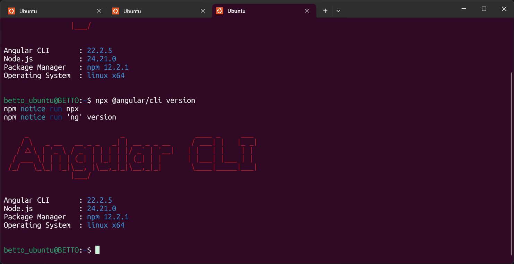
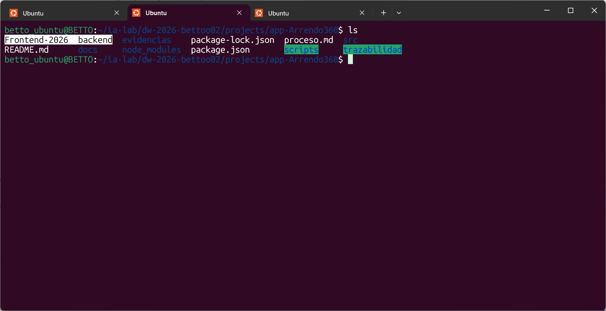
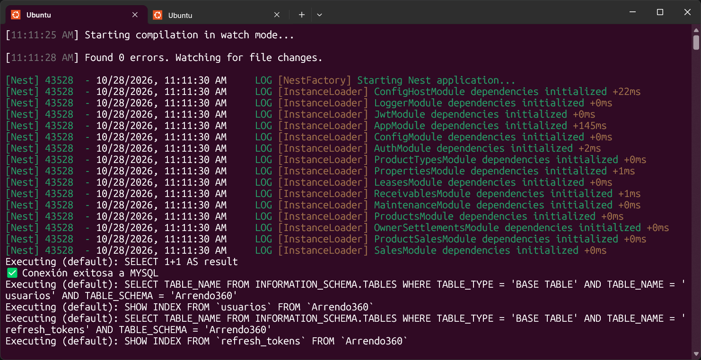
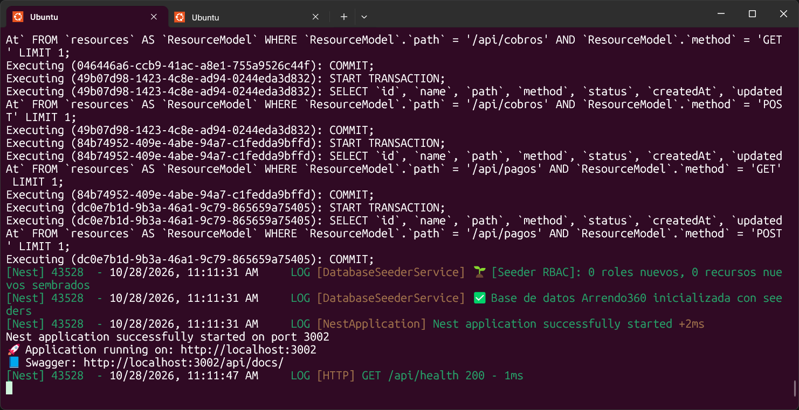
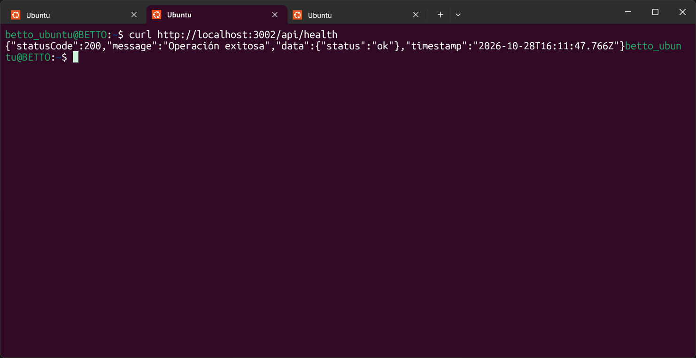

## Empecemos con el Paso 1: **ISS-00 — Requisitos previos y reconocimiento del entorno**

#### **1. ¿Qué buscamos en el ISS-00?**

En el **ISS-00** no escribimos código de aplicación todavía; nos aseguramos de que las herramientas base estén listas y que el backend de **Arrendo360 (mi proyecto)** responda correctamente para que Angular no falle al conectarse más adelante.

**2. Tarea paso a paso para completar el ISS-00**

Abre tu terminal y realiza estos **3 pasos**:

**Paso A: Instalar Angular CLI de forma global** Ejecuta en tu terminal:

```         

npm install -g @angular/cli
```

*(Si en Linux pide permisos o se prefiere no usar `sudo`, también podremos usar `npx @angular/cli` en el ISS-01, pero prueba primero si te permite instalarlo o verifica con `npx @angular/cli version`).*



**Paso B: Verificar dónde crearemos la carpeta `frontend`** Mi proyecto tiene la ruta raíz `/home/betto_ubuntu/ia-lab/dw-2026-bettoo02/projects/app-Arrendo360/`, donde hoy está la carpeta `backend/`. La idea es que `frontend/` quede como carpeta hermana al mismo nivel:

```         
text
app-Arrendo360/

├── backend/    <-- Tu API NestJS + Express + Sequelize (puerto 3002)

└── frontend/   <-- Aquí crearemos tu app Angular en el ISS-01 (puerto 4200)
```



**Paso C: Verificar que tu Backend está vivo y responde al Healthcheck** En una terminal dentro de `/home/betto_ubuntu/ia-lab/dw-2026-bettoo02/projects/app-Arrendo360/backend`, inicia el servidor (si no lo tienes corriendo):

```         
bash
npm run start:dev
```



Y comprueba en otra terminal o navegador que responde:

```         
bash
curl http://localhost:3002/api/health
```

Deberías recibir `{"statusCode":200,"data":{"status":"ok"}}`.


