## Empecemos con el Paso 1: **ISS-00 — Requisitos previos y reconocimiento del entorno**

#### **1. ¿Qué buscamos en el ISS-00?**

En el **ISS-00** no escribimos código de aplicación todavía; nos aseguramos de que las herramientas base estén listas y que el backend de **Arrendo360 (mi proyecto)** responda correctamente para que Angular no falle al conectarse más adelante.

**2. Tarea paso a paso para completar el ISS-00**

Abre tu terminal y realiza estos **3 pasos**:

**Paso A: Instalar Angular CLI de forma global** Ejecuta en tu terminal:

```         

npm install -g @angular/cli
```

*(Si en Linux pide permisos o se prefiere no usar `sudo`, también podremos usar `npx @angular/cli` en el ISS-01, pero prueba primero si te permite instalarlo o verifica con `npx @angular/cli version`).*

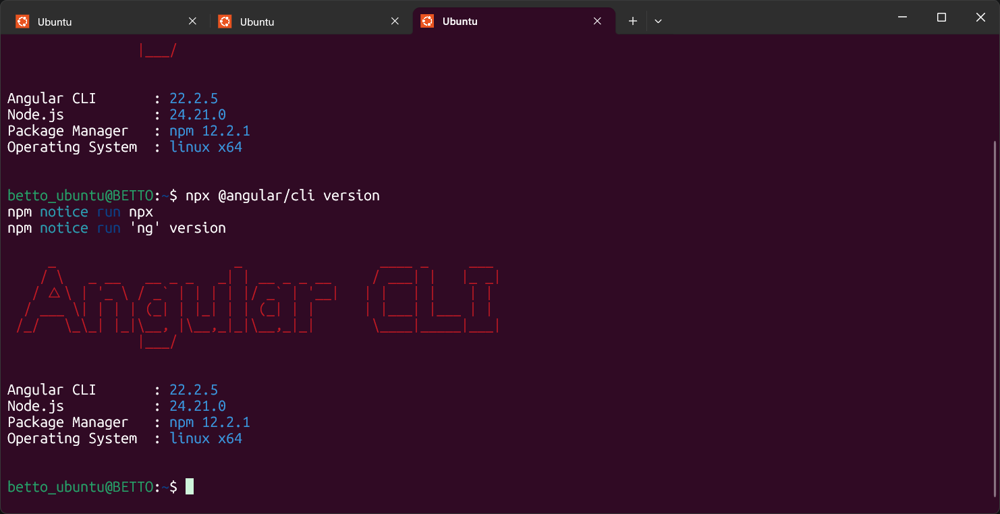

**Paso B: Verificar dónde crearemos la carpeta `frontend`** Mi proyecto tiene la ruta raíz `/home/betto_ubuntu/ia-lab/dw-2026-bettoo02/projects/app-Arrendo360/`, donde hoy está la carpeta `backend/`. La idea es que `frontend/` quede como carpeta hermana al mismo nivel:

```         
text
app-Arrendo360/

├── backend/    <-- Tu API NestJS + Express + Sequelize (puerto 3002)

└── frontend/   <-- Aquí crearemos tu app Angular en el ISS-01 (puerto 4200)
```

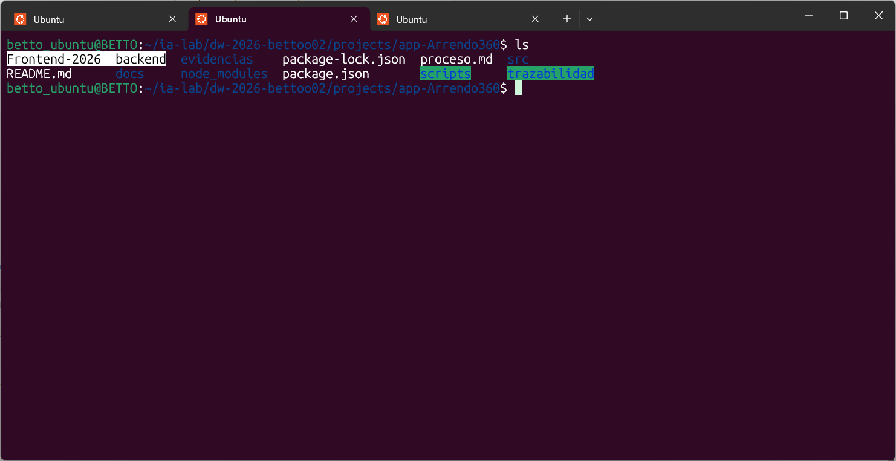

**Paso C: Verificar que tu Backend está vivo y responde al Healthcheck** En una terminal dentro de `/home/betto_ubuntu/ia-lab/dw-2026-bettoo02/projects/app-Arrendo360/backend`, inicia el servidor (si no lo tienes corriendo):

```         
bash
npm run start:dev
```

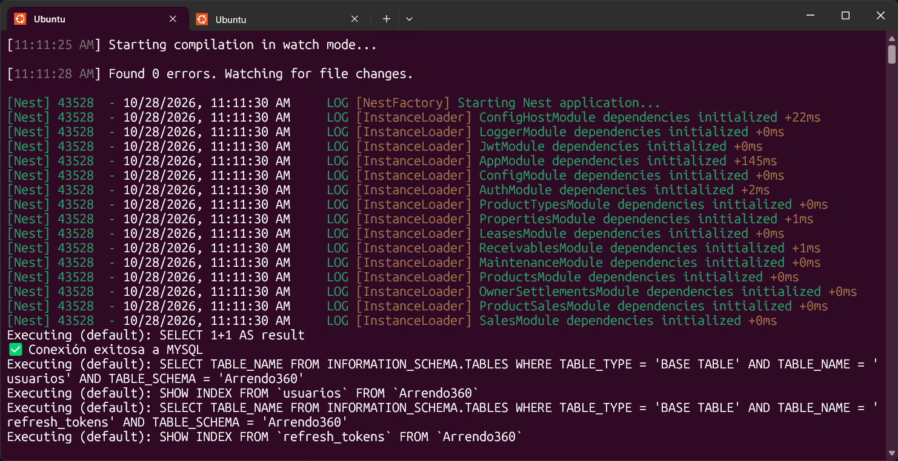

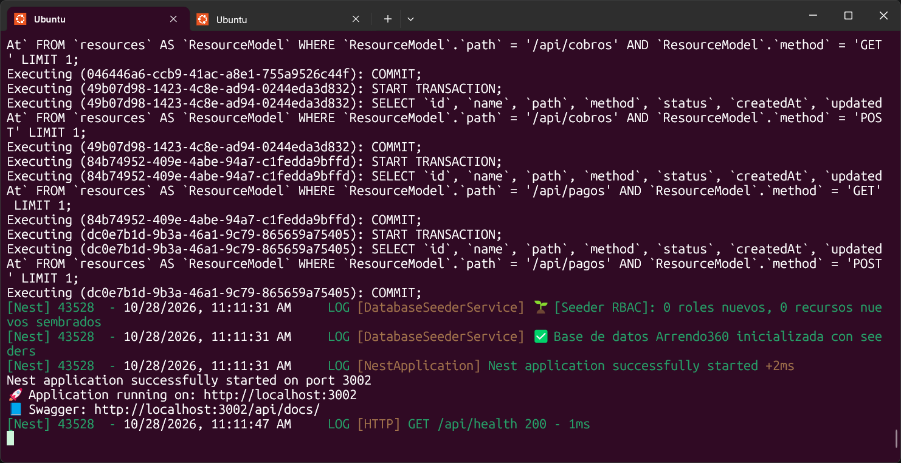Y comprueba en otra terminal o navegador que responde:

```         
bash
curl http://localhost:3002/api/health
```

Deberías recibir `{"statusCode":200,"data":{"status":"ok"}}`.

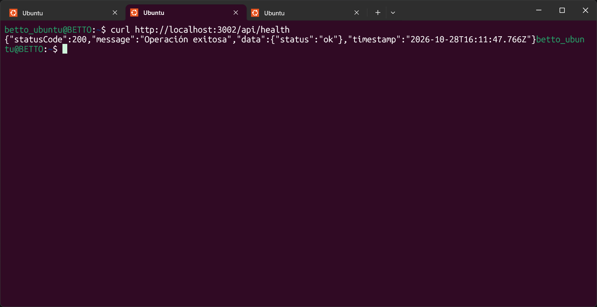

## **ISS-01 · Capa 2: Construir (Paso a paso manual)**

Sigue estos **5 pasos** desde tu terminal.

### **Paso 1: Crear el proyecto `frontend` al lado de `backend`**

Ubícate en la carpeta raíz de tu proyecto (`app-Arrendo360`) y genera el proyecto Angular:

```{bash}
cd /home/betto_ubuntu/ia-lab/dw-2026-bettoo02/projects/app-Arrendo360
npx @angular/cli@latest new frontend --style=css --routing=true --ssr=false --zoneless=true --skip-git=true
```

> **¿Por qué estos flags?**
>
> - `--style=css`: Necesario para la integración limpia con Tailwind CSS 4 (`@import "tailwindcss";`).
>
> - `--routing=true`: Crea `app.routes.ts` para navegar entre los módulos de Arrendo360.
>
> - `--ssr=false`: Crea una SPA pura en el navegador.
>
> - `--zoneless=true`: Configura la reactividad moderna basada en Signals sin `zone.js`

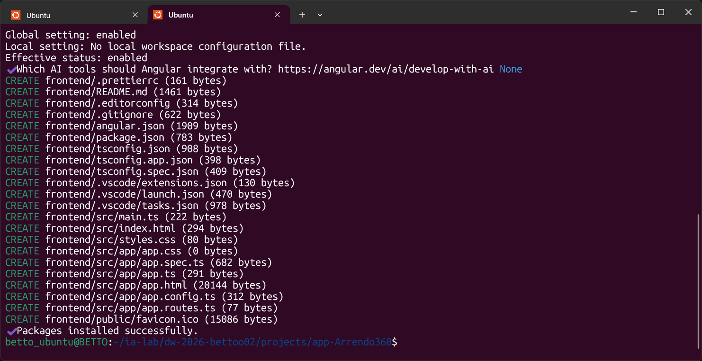

### **Paso 2: Entrar a `frontend` e instalar PrimeNG, PrimeIcons y Tailwind CSS 4**

Una vez termine de crearse la carpeta `frontend`, entra en ella e instala las dependencias de diseño:

```{bash}
cd /home/betto_ubuntu/ia-lab/dw-2026-bettoo02/projects/app-Arrendo360/frontend

# 1. Instalar PrimeNG, el tema Aura y los iconos PrimeIcons

npm install primeng @primeuix/themes primeicons

# 2. Instalar Tailwind CSS v4 y su plugin PostCSS

npm install -D tailwindcss @tailwindcss/postcss postcss
```

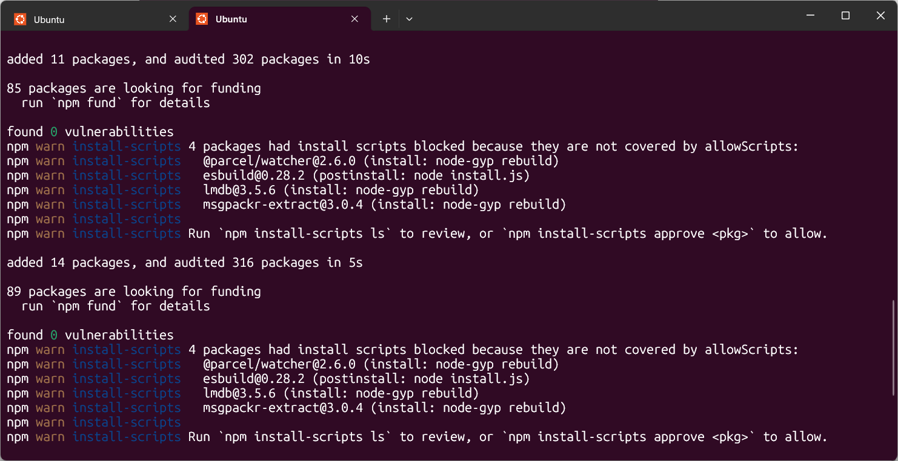

### **Paso 3: Configurar PostCSS para que Angular procese Tailwind CSS 4**

En la raíz de `frontend/` (`/home/betto_ubuntu/ia-lab/dw-2026-bettoo02/projects/app-Arrendo360/frontend/.postcssrc.json`), crea un archivo llamado **`.postcssrc.json`** con este contenido exacto:

```         
json
```

{

"plugins": {

"\@tailwindcss/postcss": {}

}

}

### **Paso 4: Configurar las capas de estilos globales en `src/styles.css`**

Abre el archivo `frontend/src/styles.css` y reemplaza su contenido por este bloque:

```         
css
```

[\@layer tailwind-base, primeng, tailwind-utilities;]{.underline}

[\@import "tailwindcss";]{.underline}

[\@import "primeicons/primeicons.css";]{.underline}

> 
>
> **Nota pedagógica:** Fíjate en la primera línea (`@layer ...`) y en que importamos `primeicons.css` para poder usar íconos como `pi pi-home`, `pi pi-building`, `pi pi-users` o `pi pi-key` en todo Arrendo360.

### **Paso 5: Configurar el Composition Root en `src/app/app.config.ts`**

Abre `frontend/src/app/app.config.ts` y configúralo para activar **Zoneless**, el **Router** y **PrimeNG con el tema Aura**:

```         
typescript
```

import { ApplicationConfig, provideZonelessChangeDetection } from '\@angular/core';

import { provideRouter } from '\@angular/router';

import { provideAnimationsAsync } from '\@angular/platform-browser/animations/async';

import { providePrimeNG } from 'primeng/config';

import Aura from '\@primeuix/themes/aura';

import { routes } from './app.routes';

export const appConfig: ApplicationConfig = {

providers: [

provideZonelessChangeDetection(),

provideRouter(routes),

provideAnimationsAsync(),

providePrimeNG({

ripple: true,

theme: {

preset: Aura,

options: {

darkModeSelector: '.app-dark',

cssLayer: {

name: 'primeng',

order: 'tailwind-base, primeng, tailwind-utilities',

},

},

},

}),

],

};

*(Nota: Si tu versión de Angular 21/22 te marca que `provideAnimationsAsync()` ya está deprecado o no es necesario en las últimas versiones de PrimeNG, me avisas o podemos omitir `provideAnimationsAsync()` ya que PrimeNG 20+ usa animaciones CSS nativas).*

## **ISS-01 · Capa 3: Criterio de Verificación**

Para comprobar que tu **ISS-01** quedó sin errores:

1.  

2.  Abre temporalmente `frontend/src/app/app.html` (o `app.component.html`), borra la plantilla de bienvenida de Angular y pon una prueba rápida de **Tailwind + PrimeNG + PrimeIcons**:

    ```         
    html
    ```

    \<div class="min-h-screen bg-slate-50 flex flex-col items-center justify-center gap-4 p-6"\>

    \<h1 class="text-3xl font-bold text-emerald-700 flex items-center gap-2"\>

    \<i class="pi pi-building text-3xl"\>\</i\>

    Arrendo360 — Frontend 2026

    \</h1\>

    \<p class="text-slate-600"\>ISS-01: Angular + Tailwind CSS 4 + PrimeNG Aura listos\</p\>

    \</div\>

3.  

4.  Ejecuta en la terminal dentro de `frontend/`:

    ```         
    bash
    ```

    npm start

5.  

6.  Abre [`http://localhost:4200`](http://localhost:4200) en tu navegador.


La terminal muestra advertencias de npm (`npm warn install-scripts`) indicando que se bloquearon los scripts de instalación automáticos de cuatro paquetes porque no están autorizados en la configuración `allowScripts`:

- `@parcel/watcher@2.6.0` (`node-gyp rebuild`)

- `esbuild@0.28.2` (`node install.js`)

- `lmdb@3.5.6` (`node-gyp rebuild`)

- `msgpackr-extract@3.0.4` (`node-gyp rebuild`)

Muchos paquetes como `esbuild` o dependencias nativas requieren ejecutar estos scripts tras la instalación para compilar o descargar binarios necesarios para su correcto funcionamiento.

### Opciones para resolverlo

**1. Permitir y compilar los paquetes bloqueados (Recomendado)**

Ejecuta el comando para aprobar individualmente cada dependencia legítima:

```{bash}
npm install-scripts approve esbuild
npm install-scripts approve @parcel/watcher
npm install-scripts approve lmdb
npm install-scripts approve msgpackr-extract
```

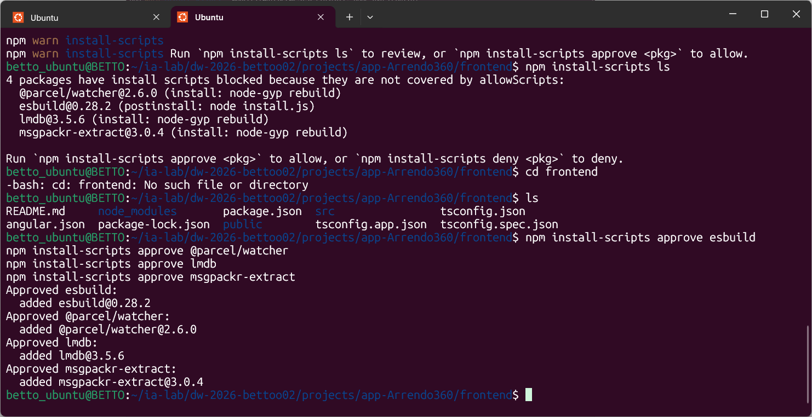

Luego vuelve a ejecutar la instalación o reconstruye los scripts:

```{bash}
npm rebuild
```

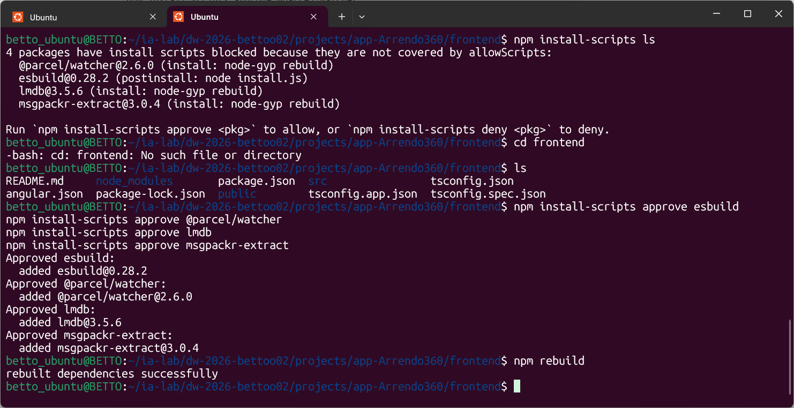

### **Paso 3: Configurar PostCSS para que Angular procese Tailwind CSS 4**

En la raíz de `frontend/` (`/home/betto_ubuntu/ia-lab/dw-2026-bettoo02/projects/app-Arrendo360/frontend/.postcssrc.json`), crea un archivo llamado **`.postcssrc.json`** con este contenido exacto:

``` json
{

  "plugins": {

    "@tailwindcss/postcss": {}

  }

}
```

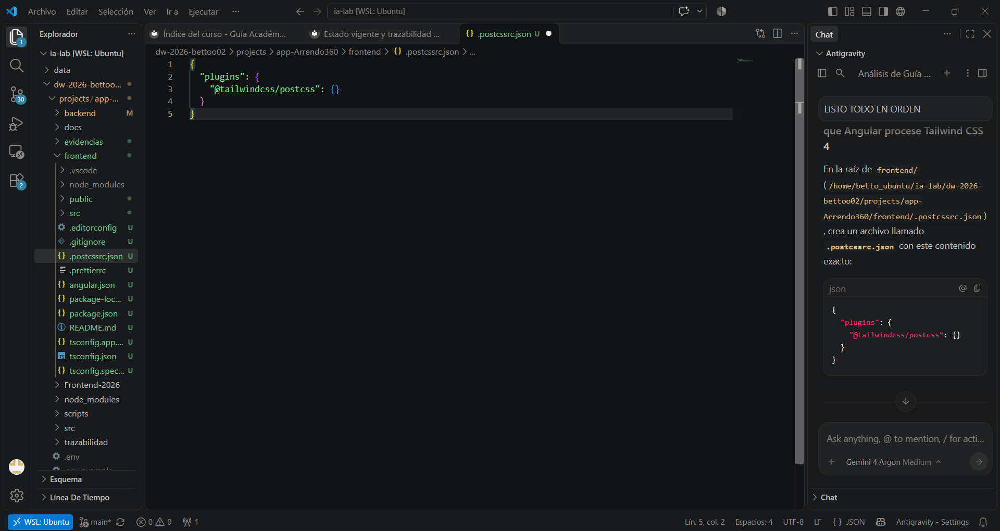

### **Paso 4: Configurar las capas de estilos globales en `src/styles.css`**

Abre el archivo `frontend/src/styles.css` y reemplaza su contenido por este bloque:

``` css
css
@layer tailwind-base, primeng, tailwind-utilities;

@import "tailwindcss";

@import "primeicons/primeicons.css";
```

>  **Nota pedagógica:** Fíjate en la primera línea (`@layer ...`) y en que importamos `primeicons.css` para poder usar íconos como `pi pi-home`, `pi pi-building`, `pi pi-users` o `pi pi-key` en todo Arrendo360.

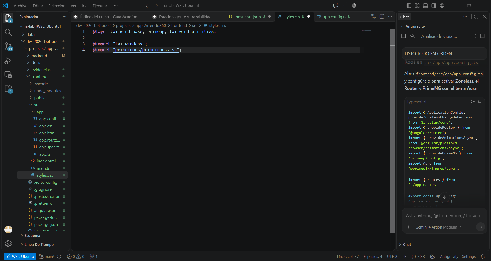

### **Paso 5: Configurar el Composition Root en `src/app/app.config.ts`**

Abre `frontend/src/app/app.config.ts` y configúralo para activar **Zoneless**, el **Router** y **PrimeNG con el tema Aura**:

``` typescript
import { ApplicationConfig, provideZonelessChangeDetection } from '@angular/core';

import { provideRouter } from '@angular/router';

import { provideAnimationsAsync } from '@angular/platform-browser/animations/async';

import { providePrimeNG } from 'primeng/config';

import Aura from '@primeuix/themes/aura';

import { routes } from './app.routes';

export const appConfig: ApplicationConfig = {

  providers: [

    provideZonelessChangeDetection(),

    provideRouter(routes),

    provideAnimationsAsync(),

    providePrimeNG({

      ripple: true,

      theme: {

        preset: Aura,

        options: {

          darkModeSelector: '.app-dark',

          cssLayer: {

            name: 'primeng',

            order: 'tailwind-base, primeng, tailwind-utilities',

          },

        },

      },

    }),

  ],

};
```

*(Nota: Si tu versión de Angular 21/22 te marca que `provideAnimationsAsync()` ya está deprecado o no es necesario en las últimas versiones de PrimeNG, me avisas o podemos omitir `provideAnimationsAsync()` ya que PrimeNG 20+ usa animaciones CSS nativas).*

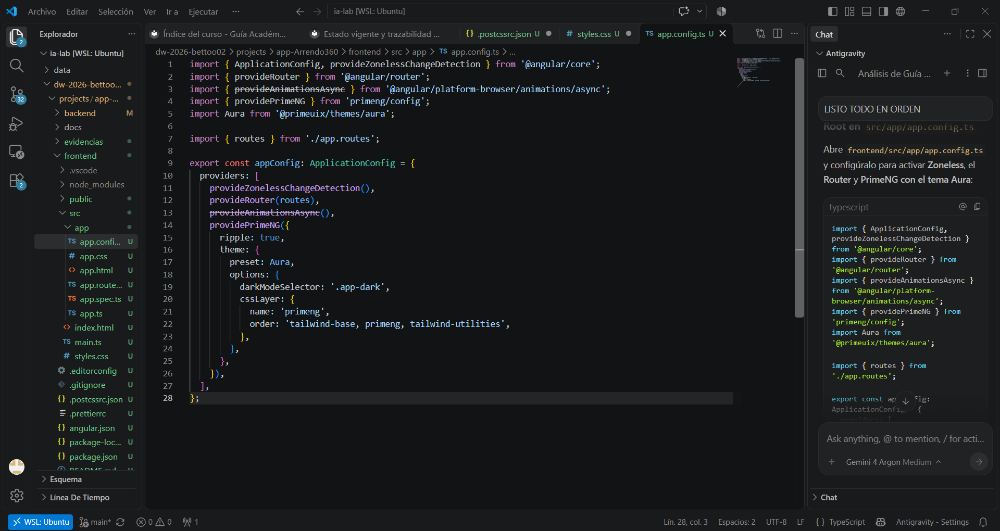

## **ISS-01 · Capa 3: Criterio de Verificación**

Para comprobar que tu **ISS-01** quedó sin errores:

1.  Abre temporalmente `frontend/src/app/app.html` (o `app.component.html`), borra la plantilla de bienvenida de Angular y pon una prueba rápida de **Tailwind + PrimeNG + PrimeIcons**:

    ``` html
    <div class="min-h-screen bg-slate-50 flex flex-col items-center justify-center gap-4 p-6">

      <h1 class="text-3xl font-bold text-emerald-700 flex items-center gap-2">

        <i class="pi pi-building text-3xl"></i>

        Arrendo360 — Frontend 2026

      </h1>

      <p class="text-slate-600">ISS-01: Angular + Tailwind CSS 4 + PrimeNG Aura listos</p>

    </div>
    ```

    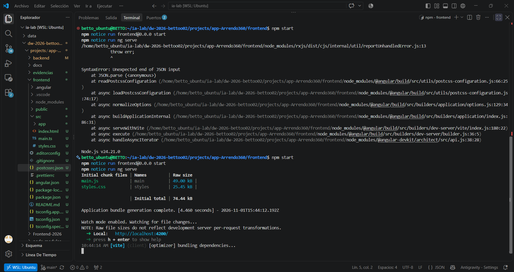

2.  Ejecuta en la terminal dentro de `frontend/`:

    ``` bash
    npm start
    ```

3.  Abre [`http://localhost:4200`](http://localhost:4200) en tu navegador.

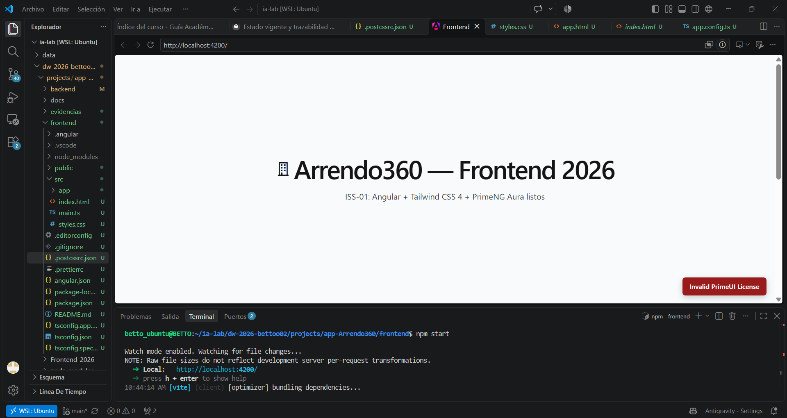
